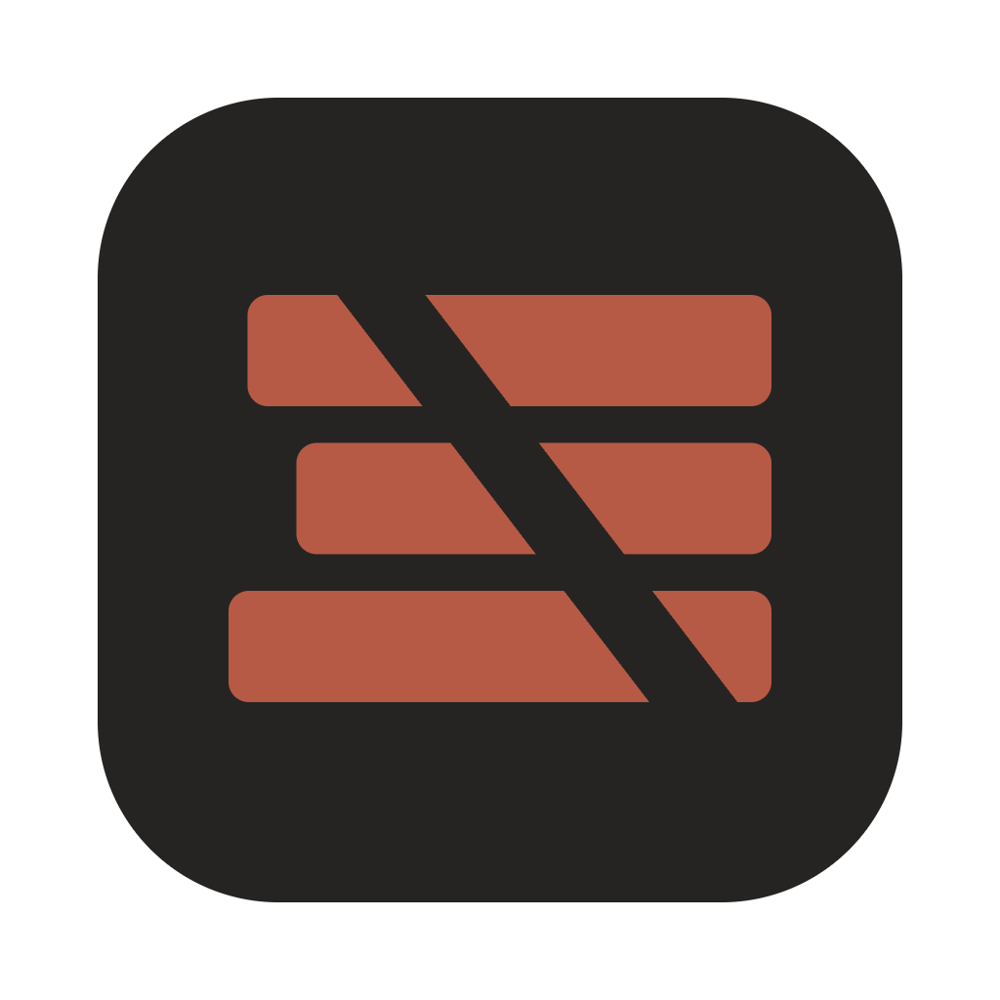
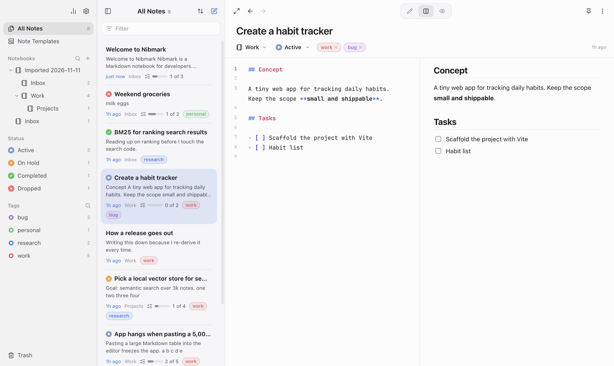

<p align="center">
  
</p>

<h1 align="center">Nibmark</h1>

<p align="center">A calm, local-first Markdown notebook for developers.</p>

---

Nibmark keeps your notes as plain Markdown, organized in nested notebooks, tags and statuses, and stored on your own machine. It is a desktop app built with Electron, React and CodeMirror 6.

> **Status:** v1.0.0, in active development. macOS is the primary target; Windows and Linux installers are built for every release but get less testing. Sync and mobile apps are on the [roadmap](#roadmap). Download the latest build from [Releases](https://github.com/quanminhvu/nibmark/releases).

<p align="center">
  
</p>

## Features

**Writing**

- CodeMirror 6 editor with Markdown and code-block syntax highlighting, line numbers and folding
- Three views: editor, side-by-side, preview; plus a full-width distraction-free mode
- Resize the sidebar, note list and editor/preview split; widths are remembered
- Bidirectional scrolling follows Markdown source blocks, keeping corresponding sections aligned around images, tables and diagrams
- Editor preferences: line numbers, readable line width, spell check, strike-through for done tasks, and wrap modes (all lines, text only, none)
- GitHub Flavored Markdown: tables, task lists, footnotes, strikethrough, sub/superscript
- Mermaid diagrams (with a zoomable full-screen viewer) and KaTeX math (`$…$`, `$$…$$`)
- Note links: type `[[` to link to another note, or create one on the fly
- Backlinks show which notes link to the current note; click one to open its source. Unlinked mentions list notes that mention its title without linking, with a button to turn each mention into a link
- Hover a note link, in the editor or the preview, to see a preview card of that note
- An outline panel (`⌘⇧O`) lists the note's headings, jumps to one on click and follows the section you are reading
- Word count and reading time for the note, or for the selected text
- Paste a URL to get `[Page title](url)`, or paste it over selected text to link that text
- Slash commands (`/`) for headings, lists, tasks, code, tables, diagrams, math, alerts, links and files
- A floating toolbar on selected text, emoji (`:smile`) and code-language suggestions
- A table toolbar: format, align, insert, delete and move rows and columns
- Multiple cursors, rectangular selection and line tools (sort, join, case); numbered lists renumber themselves
- GitHub alerts (`> [!NOTE]`, `[!TIP]`, `[!WARNING]`…), colored in the editor and the preview
- Paste or drop images and files (PDFs, archives, anything up to 100 MB) straight into a note; size images with ``, `|half`, `|full` or `|320`
- Code blocks with line numbers, a file name bar (```` ```ts title="app.ts" ````) and highlighting for about 75 languages
- A GitHub link to a line range (`…/blob/main/app.ts#L10-L25`) on its own line shows those lines in the preview
- Find in the preview with `⌘F`
- Click a checkbox in the preview to tick the task in the source

**Present and explore**

- Present a note as full-screen slides: each part separated by a `---` line is a slide; move with the arrow keys and start from the slide you are editing
- A graph view (`⌘⇧G`) of how notes link to each other, for all notes or just the ones around the current note
- Export a note as PDF (A4, page numbers, code blocks and tables kept whole)

**Kanban boards**

- Add `view: kanban` to a note's front matter and the preview becomes a board: each `##` heading is a column, each list item a card
- Drag cards between columns, add, rename, check off and delete them; every change is written back to the Markdown
- Start from the built-in Kanban Board template (`⌘T`)

**Organizing**

- Nested notebooks with icons and a manual order
- Custom statuses alongside the built-in ones; pick a status from a searchable list with colored icons, or type a new name to create one on the spot
- Tag suggestions show each tag's color and note count; type a new name to create a tag, and click a tag on a note to see every note with it
- Edit tags and statuses right in the sidebar: double-click to rename, or use the ⋯ button for a dialog with a live preview, a color palette (or any custom color) and, for statuses, more than 1,500 icons
- Drag statuses and tags into your preferred order; the order persists and is included in backups
- Delete a status without losing content: affected notes and templates move to No status
- Pin, duplicate, trash and restore notes; drag notes onto notebooks, statuses, tags or the Trash
- Select several notes (`⌘`-click, `⇧`-click, `⌘A`) to move, tag, set status, pin or trash them together
- Version history with a line diff and one-click restore
- Tabs: double-click a note to keep it open in a tab; switch with `Ctrl+Tab` or `⌘1`…`⌘9`, close with `⌘W`, drag to reorder. Each note remembers its cursor and scroll position
- Today's note (`⌘⇧T` or the Today row in the sidebar) opens or creates the note for today from your daily template
- Back and forward between notes, like a browser, with buttons, shortcuts or a two-finger swipe
- Open a note in its own window (`⌘⇧N`)
- Search with qualifiers: `book:` `tag:` `status:` `title:` `body:` `"exact phrase"` `-exclude`
- Every open task across your notes in the command palette (type `[`)
- Templates with `{{date}}`, `{{time}}` and `{{weekday}}` placeholders, a preview before you pick one, and an optional notebook for new notes; six built-in templates
- An activity view: writing streaks and a year grid of notes created, notes edited and tasks completed

**Your data**

- Local-first storage in PouchDB (IndexedDB), ready for CouchDB sync
- Continuous JSON backup to a folder of your choice; backups never delete files
- Restore from a backup folder (merge: newer notes in the app are never overwritten)
- Attachments are backed up as their original files and exported to an `attachments/` folder
- Import from Markdown folders (Obsidian, Notion exports and `.zip`s, Bear TextBundles), HTML files, Evernote `.enex` files and Apple Notes
- Import Kindle highlights from `My Clippings.txt`; importing again only adds new highlights
- Export a note, a notebook or everything as Markdown files with YAML front matter, or a note as a single HTML file or a PDF
- Let AI agents such as Claude Code search, read, create and edit your notes through MCP ([details](#use-your-notes-from-ai-agents-mcp))
- Drag a note into another app or a terminal to paste a link to it

**Make it yours**

- Command palette (`⌘K`) for notes, commands, notebooks, tags, headings, tasks and themes, and a note actions menu (`⌘J`)
- Six built-in themes: Mist and Night (the defaults for light and dark), Paper, Stone, Ink and Indigo
- Global shortcuts for a quick note and for showing or hiding Nibmark; on Windows and Linux, an optional system tray icon
- Write your own themes as CSS files, and tweak anything with a personal `styles.css`

## Keyboard shortcuts

| Shortcut | Action |
| --- | --- |
| `⌘N` | New note |
| `⌘T` | New note from template |
| `⌘K` | Command palette (`>` commands, `@` notebooks, `#` tags, `:` headings, `[` tasks) |
| `⌘J` | Actions for the current note (move, tag, status, export…) |
| `⌘D` | Duplicate the note (outside the editor) |
| `⌘⇧N` | Open the note in a new window |
| `⌘⇧T` | Today's note |
| `⌘⇧O` | Outline panel |
| `⌘⇧G` | Graph view |
| `⌘W` | Close the tab (or the window when no tab is open) |
| `Ctrl+Tab` / `Ctrl+⇧Tab` | Next / previous tab |
| `⌘1` … `⌘9` | Go to a tab (`⌘9` is the last one) |
| `⌘F` | Find in the editor, or in the preview when the editor isn't focused |
| `⌘E` | Toggle preview |
| `⌘P` | Toggle side-by-side view |
| `⌘⇧D` | Distraction-free mode |
| `⌘⇧F` | Search notes |
| `⌘⌥N` | Quick Note from anywhere (global, configurable) |
| `⌘⌥←` / `⌘⌥→` | Back / forward between notes |
| `⌘,` | Preferences |
| `⌘B` / `⌘I` | Bold / italic |
| `⌘`-click | Follow a note link in the editor |

On Windows and Linux, use `Ctrl` instead of `⌘`.

## Getting started

Requirements: Node.js 22 (see `.nvmrc`) and npm.

```bash
npm install
npm run dev        # start the app with hot reload
```

Other scripts:

| Script | What it does |
| --- | --- |
| `npm run build` | Build main, preload and renderer into `out/` |
| `npm run start` | Run the built app |
| `npm run typecheck` | Type-check the whole project |
| `npm run verify` | Typecheck, build and check that main/preload bundle all their dependencies |
| `npm run pack` | Package an unpacked app into `dist/` (on macOS: `dist/mac-arm64/Nibmark.app`) |
| `npm run test:smoke` | Launch the packaged app on a temporary profile and check that it starts |
| `npm run test:desktop` | Drive the built app on a temporary profile through statuses, tags, ordering, backlinks and scrolling |
| `npm run test:scroll` | Check the editor/preview scroll mapping |
| `npm run dist` | Build installers: `.dmg`/`.zip` (macOS), `.exe` (Windows), `.AppImage` (Linux) |

See [CONTRIBUTING.md](CONTRIBUTING.md) for the development workflow, CI and the release process.

To run against a throwaway profile (useful when testing, so your real notes are never touched):

```bash
NIBMARK_USER_DATA="$PWD/.tmp-profile" npm run dev
```

## Use your notes from AI agents (MCP)

Nibmark can act as an [MCP](https://modelcontextprotocol.io) server, so Claude Code, Claude Desktop, Cursor and other agents can search, read, create, edit and delete your notes.

1. Turn it on in **Preferences → AI Agents (MCP)**. It is off by default. A second switch limits agents to reading.
2. Copy the command shown there. For Claude Code on macOS it looks like this:

   ```bash
   claude mcp add nibmark -e ELECTRON_RUN_AS_NODE=1 -- /Applications/Nibmark.app/Contents/MacOS/Nibmark /Applications/Nibmark.app/Contents/Resources/mcp.js
   ```

   For Claude Desktop or Cursor, use **Copy JSON** and paste it into the client's MCP config file.

The bridge (`resources/mcp.js`) runs with the Node that ships inside Nibmark and talks to the running app over a local socket that only your user account can open. No network port is opened. If Nibmark is not running, the bridge starts it.

| Tool | What it does |
| --- | --- |
| `search_notes` | Search with the app's syntax (`tag:`, `book:`, `status:`, `-exclude`); an empty query lists recent notes |
| `read_note`, `get_backlinks` | Read a note's Markdown and details, or the notes linking to it |
| `list_notebooks`, `list_tags`, `list_statuses` | See how notes are organized |
| `create_note`, `append_to_note` | Create a note, or append to one (today's daily note by default) |
| `edit_note`, `update_note` | Replace exact text, or change the title, body, notebook, tags, status or pin |
| `trash_note`, `restore_note` | Move a note to the Trash and back. Agents cannot delete permanently |

Every change goes through the app, so it shows up immediately and is kept in the note's version history.

## Where your data lives

Everything is stored in the app's user data folder (`~/Library/Application Support/Nibmark` on macOS):

| Path | Contents |
| --- | --- |
| `IndexedDB/` | The note database, attachments and version history |
| `Backups/` | Default continuous backup folder (change it in Preferences) |
| `themes/*.css` | Your own themes |
| `styles.css` | Your personal CSS overrides |
| `settings.json` | Backup folder, global shortcuts, tray and MCP settings |
| `mcp.sock` | Local socket for AI agents, only while MCP is on (macOS and Linux) |

### Writing a theme

Create a `.css` file in the themes folder (Preferences → Open Themes Folder). A theme inherits every color from its base and only overrides what you write:

```css
/* name: Moss */
/* base: paper */
--paper: #e9ede2;
--surface: #f1f4eb;
--accent: #4f7a3a;
```

Bases are `mist`, `night`, `paper`, `stone`, `ink` and `indigo`. See `src/renderer/src/themes.css` for every variable.

## Project structure

```
src/
├── main/                 Electron main process
│   ├── index.ts          Windows, app lifecycle
│   ├── windows.ts        Tracks the main window (note windows are separate)
│   ├── menu.ts           Application menu
│   ├── ipc.ts            IPC handlers (dialogs, backup, import, export, themes, web)
│   ├── backup.ts         Continuous JSON backup and restore reader
│   ├── exporter.ts       Markdown export to folders
│   ├── importer.ts       Reads files, folders and archives picked for import
│   ├── appleNotes.ts     Apple Notes import (JXA)
│   ├── web.ts            Page titles and GitHub snippets (http/https only, size and time limits)
│   ├── pdf.ts            PDF export from a hidden window
│   ├── mcp.ts            Local socket for AI agents (MCP), forwarded to the main window
│   ├── shortcuts.ts      Global shortcuts
│   ├── tray.ts           System tray (Windows, Linux)
│   ├── settings.ts       settings.json in the user data folder
│   └── themes.ts         User themes and styles.css
├── preload/index.ts      The only bridge between renderer and main
└── renderer/src/
    ├── App.tsx           Layout and global shortcuts
    ├── components/       Sidebar, note list, editor, preview, palette, preferences…
    ├── lib/              Store, database, search, Markdown, backup, themes, templates…
    ├── themes.css        Built-in themes (CSS variables)
    └── styles.css        Layout and components
resources/mcp.js          MCP bridge (stdio) that AI agents start; talks to the app's socket
assets/icon/              Icon and logo sources (SVG + PNG)
build/                    Packaging resources (icon.icns)
docs/                     Roadmap and screenshot
```

### Design principles

- **Local-first.** The app works fully offline; sync will be an add-on, not a requirement.
- **The renderer never chooses file paths.** It runs sandboxed; every file write goes through main, either to a configured folder or to a path the user picked in a native dialog.
- **Backups are append-only.** Deleted notes are moved to `deleted/`, never removed, so an empty or broken database can't wipe a backup.
- **All colors are CSS variables**, so themes can restyle the editor, the preview and Mermaid diagrams alike.

## Roadmap

- [x] **Phase 1 — Desktop app (0.1–0.3):** editor, notebooks, tags, statuses, search, backup, import and export, themes, command palette, templates, note links, Mermaid and math, attachments, version history
- [x] **Phase 2 — A better everyday experience (0.4–0.8):** new look, Kanban boards, editor and preview improvements, tasks palette, note windows, activity view, Apple Notes and Kindle import, HTML and PDF export, resizable panes, custom statuses, backlinks and unlinked mentions, easier status and tag editing, tabs, outline, today's note, slides and graph view
- [ ] **Phase 3 — Sync and security:** CouchDB sync, end-to-end encryption
- [ ] **Phase 4 — Mobile, plugins and AI:** iOS and Android apps, plugin system, optional AI assistant (the MCP server for AI agents is already available)
- [ ] **Phase 5 — Distribution:** signed builds, accounts

The detailed roadmap is in [`docs/ROADMAP.md`](docs/ROADMAP.md).

## License

Nibmark is released under the [MIT License](LICENSE).

The Nibmark name, icon and logo identify this project; please don't use them in a way that suggests your fork is the official app.
