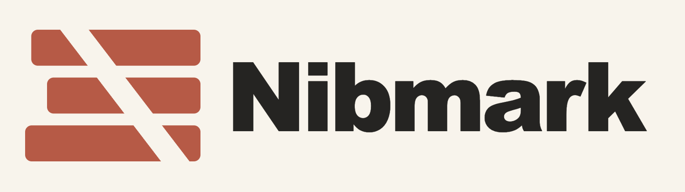

# Nibmark — Text N

The Text N mark combines three text rows with a diagonal cut. Use the brick-red mark on charcoal for the app icon and the horizontal logo for project documentation.



| Asset | Use |
| --- | --- |
| `nibmark-mark.svg` | Standalone brick-red mark, transparent background |
| `nibmark-mark-monochrome.svg` | Single-color mark; uses `currentColor` when embedded inline |
| `nibmark-icon.svg` | App icon master, with a charcoal rounded square and transparent outer margin |
| `nibmark-icon-1024.png` | 1024 × 1024 app icon preview |
| `nibmark-logo-horizontal.svg` | Editable horizontal mark and wordmark |
| `nibmark-logo-horizontal.png` | Rendered horizontal logo for README and documentation |

Colors: brick red `#B65A46`, charcoal `#252422`, paper `#F8F4EC`.

## Regenerate

```sh
npm ci
npm run icons
```

Run on macOS to regenerate the complete set, including `build/icon.icns` via Apple's `iconutil`. The horizontal SVG uses Arial Black with fallbacks; use macOS with Arial Black installed to match the checked-in PNG. The PNG is the portable wordmark asset.

The script renders SVGs through the project's Electron runtime and updates:

- `assets/icon/nibmark-icon-1024.png`
- `assets/icon/nibmark-logo-horizontal.png`
- `resources/icon.png` for the development Dock icon, app windows and system tray
- `build/icon.png` for Windows/Linux packaging
- `build/icon.icns` for macOS packaging (16–1024 px representations)

The renderer favicon references `nibmark-icon.svg` directly through Vite. Keep the standalone marks and icon/logo SVG geometry synchronized when changing the mark. Commit the SVG sources and generated files together. Do not substitute concept presentation images for production assets.

The application screenshot in `docs/screenshot.png` contains no brand icon and remains a UI illustration.
